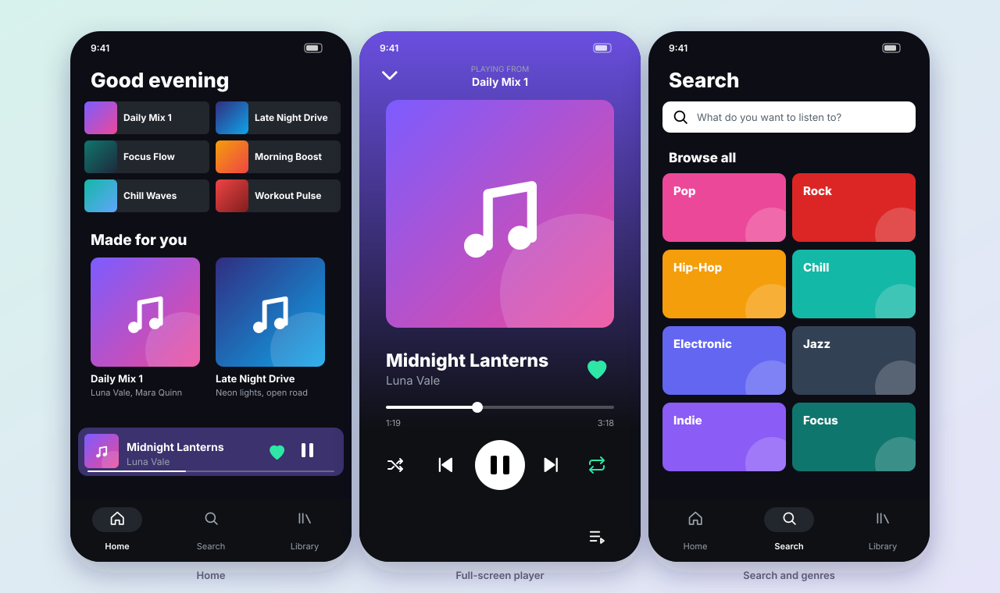

# 🎵 Flutter Music Player UI (Streaming App)



<sub>Preview: design illustration of the screens. Run the app to see the real thing.</sub>

A free Flutter template for a music streaming app: **home with shelves, search with genres, library, playlist pages, a mini player and a full-screen player** with seek bar, shuffle, repeat, likes and a play queue. Material 3, dark theme, **no extra packages and no backend**.

## Features

- **Home**: greeting, quick-access grid, "Made for you" and "Recently played" shelves, popular artists
- **Search**: live search by song, artist, album or genre, plus a "Browse all" genre grid
- **Library**: playlists, artists and a Liked Songs list that follows your hearts
- **Playlist page**: cover, duration, play and shuffle buttons, track list with an equalizer icon on the playing song
- **Mini player**: always visible above the navigation bar, with like, play/pause and progress
- **Full-screen player**: seek slider, previous/next, shuffle, repeat (off, all, one), like and queue
- **Queue**: see what is next, tap to jump, remove songs, "Play next" and "Add to queue" from every track menu
- **Cover art drawn in code** (gradients), so there are no image assets to license

> **Playback is simulated.** A timer moves the progress bar; no audio plays. All artists, albums and songs are fictional demo data. See "Play real audio" below.

## Run it

```bash
flutter create . --platforms=android,ios,web
flutter pub get
flutter run
```

`flutter create .` only adds the platform folders and keeps this repo's `lib/` and `pubspec.yaml`. Needs Flutter 3.32 or newer. Run the tests with `flutter test`.

## Play real audio

The whole player lives in `lib/player/player_controller.dart`. To stream real files:

1. Add an audio package such as `just_audio` and give each `Track` a `url`.
2. Call the package from `play()`, `pause()`, `seek()` and when the current track changes (`next`, `previous`, `jumpTo`).
3. Replace the timer in `_syncTimer()` with the package's position stream.

For background playback and lock-screen controls, look at `audio_service`.

## Use your own data

Edit `lib/data/seed.dart`, or load the same `Track`, `Playlist` and `Artist` models from your API.

## Structure

```text
lib/
  main.dart                  app + PlayerScope
  core/                      theme, formatting, scope, cover art
  data/                      models and demo data
  player/player_controller.dart   queue, shuffle, repeat, likes, timer
  features/                  home, search, library, playlist, mini player, now playing, queue
test/player_test.dart        unit tests for the player logic
```

## License

MIT. Free for personal and commercial use.
